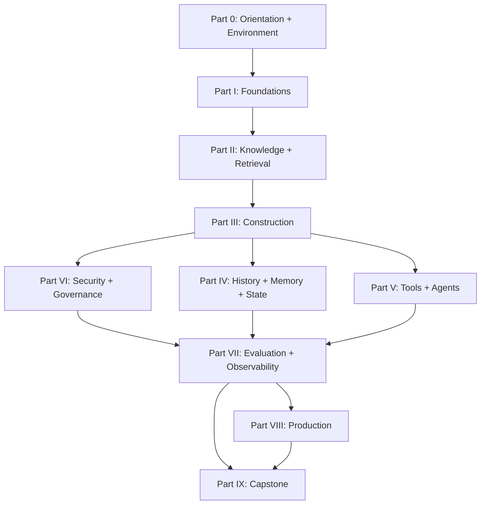

# Curriculum — Context Engineering

This document is the authoritative map of the learning curriculum. It defines what Context Engineering means in this repository, what each part and chapter teaches, the order in which to study, and the criteria for moving on. The live build status of every chapter, lab, and project is tracked in [`ROADMAP.md`](ROADMAP.md).

## How to read this document

- **Parts** are ordered by dependency. Each part lists its chapters with focus, prerequisites, and the artifacts (notes, code, labs, projects) that implement it.
- **Essential vs. optional**: chapters marked *(optional)* can be skipped on a first pass without breaking the sequence; everything else is required for later parts.
- **The longitudinal example**: a synthetic corporate knowledge base for the fictional company **Nimbus Dynamics** (see `datasets/synthetic/`) is used across the whole curriculum. One system evolves from raw documents (Part II) to a budgeted, secure, evaluated assistant (Parts VII–IX). Chapters reuse and extend it instead of inventing disconnected examples.

## Working definition

**Context Engineering** is the systematic design and management of the information available to a model at a particular inference or agent-execution step. It covers selecting, retrieving, structuring, ordering, compressing, labeling, isolating, updating, and evaluating contextual information across an application's lifecycle.

It is distinct from — and complements — these adjacent disciplines:

| Discipline | Owns | Relationship to Context Engineering |
|---|---|---|
| Prompt engineering | Instructions, examples, constraints, output expectations | The instruction layer *inside* the broader context |
| Context engineering (this repo) | Everything the model sees at inference time | The umbrella discipline for assembling and governing that information |
| Retrieval-Augmented Generation | Fetching external evidence to ground responses | One component of a larger context system |
| Memory engineering | Information retained across interactions | A source feeding the context, plus its own storage policies |
| Agent engineering | Decisions, tools, control flow, execution loops | Consumes context decisions at every step |
| Data / knowledge management | Preparing and governing source information | Upstream dependency for reliable context |
| Evaluation engineering | Measuring whether the system meets requirements | The feedback loop that improves context decisions |

## Part 0 — Orientation, Prerequisites, Environment (chapters/00-orientation/)

| # | Chapter | Focus | Prerequisites |
|---|---|---|---|
| 0.1 | [Introduction to the Repository](chapters/00-orientation/chapter-01-introduction.md) | Purpose, audience, outcomes, navigation | None |
| 0.2 | [Prerequisite Knowledge](chapters/00-orientation/chapter-02-prerequisites.md) | Minimum concepts: Python, JSON, HTTP/APIs, Git, LLM basics | None |
| 0.3 | [Environment Setup and First Experiment](chapters/00-orientation/chapter-03-environment-setup.md) | Reproducible setup, running tests, first deterministic experiment | 0.1, 0.2 |

**Outcomes:** you can run the repository's tests, run the first experiment, and explain the difference between a deterministic demonstration and model-dependent behavior.

## Part I — Foundations (chapters/01-foundations/)

| # | Chapter | Focus | Prerequisites |
|---|---|---|---|
| 1 | [Context Engineering Fundamentals](chapters/01-foundations/chapter-01-fundamentals.md) | Definition, motivation, adjacent disciplines, lifecycle, architectures | Part 0 |
| 2 | [LLM Inputs, Tokens, and Context Windows](chapters/01-foundations/chapter-02-tokens-and-windows.md) | Tokenization, budgets, estimation and its limits, why bigger windows ≠ better | Ch. 1 |
| 3 | [Anatomy of Context](chapters/01-foundations/chapter-03-anatomy-of-context.md) | Component taxonomy: instructions, input, history, evidence, memory, tools, state | Ch. 1 |
| 4 | [Context Quality and Failure Diagnosis](chapters/01-foundations/chapter-04-quality-and-diagnosis.md) | Failure taxonomy and a systematic diagnostic process | Ch. 2, 3 |

**Outcomes:** you can classify every piece of a model request into a component kind, estimate its token cost, name the plausible failure modes, and distinguish a context problem from a model, data, application, or evaluation problem.

## Part II — Knowledge Sources, Ingestion, and Retrieval (chapters/02-knowledge-and-retrieval/)

| # | Chapter | Focus | Prerequisites |
|---|---|---|---|
| 5 | [Designing a Reliable Knowledge Corpus](chapters/02-knowledge-and-retrieval/chapter-05-corpus-design.md) | Sources, quality, authority, versioning, metadata, governance | Part I |
| 6 | [Document Ingestion and Normalization](chapters/02-knowledge-and-retrieval/chapter-06-ingestion.md) | Parsing, extraction, structure preservation, provenance | Ch. 5 |
| 7 | [Chunking, Indexing, and Retrieval Fundamentals](chapters/02-knowledge-and-retrieval/chapter-07-chunking-and-retrieval.md) | Boundaries, size/overlap trade-offs, lexical & semantic retrieval, hybrid search | Ch. 6 |
| 8 | [Advanced Retrieval and Search Planning](chapters/02-knowledge-and-retrieval/chapter-08-advanced-retrieval.md) | Query rewriting, decomposition, reranking, when extra stages are worth it | Ch. 7 |
| 9 | [Provenance, Freshness, and Access-Aware Retrieval](chapters/02-knowledge-and-retrieval/chapter-09-provenance-freshness-access.md) | Source identity, versions, staleness, authorization *before* assembly | Ch. 7 |

**Outcomes:** you can build a small, governed corpus (done here: the Nimbus Dynamics corpus), chunk it sensibly, index it lexically, retrieve with metadata filters, and explain when a vector database is — and is not — justified.

## Part III — Dynamic Context Construction (chapters/03-context-construction/)

| # | Chapter | Focus | Prerequisites |
|---|---|---|---|
| 10 | [The Context Engineering Lifecycle](chapters/03-context-construction/chapter-10-lifecycle.md) | The 12-step iterative process; what to skip when | Part II |
| 11 | [Context Selection and Relevance](chapters/03-context-construction/chapter-11-selection.md) | Relevance, diversity, authority, freshness; limits of similarity scores | Ch. 10 |
| 12 | [Context Budgeting and Allocation](chapters/03-context-construction/chapter-12-budgeting.md) | Allocation across component kinds, truncation, reserved output, degradation | Ch. 2, 10 |
| 13 | [Context Ordering and Position Effects](chapters/03-context-construction/chapter-13-ordering.md) | Ordering strategies, long-context research (Lost in the Middle), validation protocol | Ch. 10 |
| 14 | [Context Compression and Summarization](chapters/03-context-construction/chapter-14-compression.md) | Deletion, extraction, structured notes; what must survive compression | Ch. 12 |
| 15 | [Progressive Context Disclosure](chapters/03-context-construction/chapter-15-progressive-disclosure.md) | Upfront vs. on-demand loading, references, staged retrieval | Ch. 11 |
| 16 | [Context Caching, Reuse, and Invalidation](chapters/03-context-construction/chapter-16-caching.md) | App vs. retrieval vs. provider caching; keys, invalidation, isolation | Ch. 12 *(optional on first pass)* |

**Outcomes:** you can take a pile of candidate information and produce a budgeted, ordered, labeled context — and justify every inclusion, exclusion, and truncation decision.

## Part IV — History, Memory, and State (chapters/04-memory-and-state/)

| # | Chapter | Focus | Prerequisites |
|---|---|---|---|
| 17 | [Conversation History and Short-Term Context](chapters/04-memory-and-state/chapter-17-history.md) | Retention, rolling summaries, trimming, pinned constraints | Part III |
| 18 | [Persistent Memory Engineering](chapters/04-memory-and-state/chapter-18-memory.md) | Memory kinds, extraction, conflicts, expiration, deletion, auditability | Ch. 17 |
| 19 | [Structured State, Checkpoints, and Recovery](chapters/04-memory-and-state/chapter-19-state.md) | Context vs. memory vs. state; resume after interruption | Ch. 17 |

**Outcomes:** you can manage bounded history, run an inspectable memory store with conflict handling and expiry, and checkpoint/resume a task with the minimum reconstructable information.

## Part V — Tools, Agents, and Multimodal Context (chapters/05-tools-agents-multimodal/)

| # | Chapter | Focus | Prerequisites |
|---|---|---|---|
| 20 | [Tool Context and External Interactions](chapters/05-tools-agents-multimodal/chapter-20-tool-context.md) | Tool definitions, schemas, permissions, output handling, errors as context | Part III |
| 21 | [Context Across Multi-Step Agent Workflows](chapters/05-tools-agents-multimodal/chapter-21-multi-step-workflows.md) | Per-stage context, handoffs, intermediate artifacts, recovery | Ch. 20, 19 |
| 22 | [Multi-Agent Context Isolation and Delegation](chapters/05-tools-agents-multimodal/chapter-22-multi-agent.md) | Shared vs. private context, delegation summaries, when multi-agent is justified | Ch. 21 |
| 23 | [Multimodal Context Engineering](chapters/05-tools-agents-multimodal/chapter-23-multimodal.md) | Modality sources, derived representations, alignment, budgets | Ch. 3 *(optional)* |

**Outcomes:** you can design tool definitions that aid selection, build a multi-step workflow with explicit per-stage context, and reason about when multi-agent complexity pays for itself.

## Part VI — Security, Privacy, and Governance (chapters/06-security-and-governance/)

| # | Chapter | Focus | Prerequisites |
|---|---|---|---|
| 24 | [Prompt Injection and Untrusted Context](chapters/06-security-and-governance/chapter-24-prompt-injection.md) | Threat model, trust boundaries, labeling, least privilege, layered defenses | Part III |
| 25 | [Privacy, Multi-Tenancy, and Sensitive Information](chapters/06-security-and-governance/chapter-25-privacy.md) | Minimization, tenant isolation in retrieval/caches/memory, redaction, deletion | Ch. 9, 24 |
| 26 | [Provenance, Governance, and Lifecycle Management](chapters/06-security-and-governance/chapter-26-governance.md) | Data lifecycle, audit trails, retention, change management, traceability | Ch. 9, 18 |

**Outcomes:** you can label trust levels, enforce access control before assembly, screen and wrap untrusted content, and demonstrate — with tests — that cross-tenant leakage and injection payloads fail safely. You understand why prompt wording alone is never a security boundary.

## Part VII — Evaluation, Testing, and Observability (chapters/07-evaluation-and-observability/)

| # | Chapter | Focus | Prerequisites |
|---|---|---|---|
| 27 | [Measuring Context Quality](chapters/07-evaluation-and-observability/chapter-27-measuring-quality.md) | The six quality levels; relevance, coverage, redundancy, token, cost metrics | Part III |
| 28 | [Test-Driven Context Engineering](chapters/07-evaluation-and-observability/chapter-28-test-driven.md) | Fixtures, golden sets, edge/adversarial cases, ablations; deterministic-first | Ch. 27 |
| 29 | [Context Debugging and Observability](chapters/07-evaluation-and-observability/chapter-29-debugging-observability.md) | Stage traces, metrics (latency/tokens/cost/failures), redaction-first logging | Ch. 28 |

**Outcomes:** you can run and extend the repository's evaluation harness, interpret a suite report, run ablations, and debug a failure from a stage-level trace.

## Part VIII — Reliability, Performance, and Production (chapters/08-production-engineering/)

| # | Chapter | Focus | Prerequisites |
|---|---|---|---|
| 30 | [Reliable Context Pipelines](chapters/08-production-engineering/chapter-30-reliable-pipelines.md) | Modularity, validation, retries, fallbacks, graceful degradation | Part VII |
| 31 | [Performance, Cost, and Scalability](chapters/08-production-engineering/chapter-31-performance-cost.md) | Token economics, latency, caching, batching, trade-off analysis | Ch. 30 |
| 32 | [Deployment, Monitoring, and Maintenance](chapters/08-production-engineering/chapter-32-deployment.md) | Config, secrets, versioning, regression detection, rollback | Ch. 30 |
| 33 | [Provider and Framework Comparisons](chapters/08-production-engineering/chapter-33-provider-comparisons.md) | Decision criteria; baseline before framework; verify-before-rely | Ch. 30 *(optional)* |

**Outcomes:** you can harden a pipeline with retries/fallbacks, reason about cost/latency trade-offs, and evaluate whether a framework earns its complexity.

## Part IX — Integration Projects and Capstone (chapters/09-capstone/)

| # | Chapter | Focus | Prerequisites |
|---|---|---|---|
| 34 | [First-Principles Reference Implementation](chapters/09-capstone/chapter-34-reference-implementation.md) | Guided tour of the `context_engineering` library as a capstone of concepts | Parts I–VI |
| 35 | [Context-Aware Knowledge Assistant](chapters/09-capstone/chapter-35-knowledge-assistant.md) | Build: retrieve → filter → screen → budget → assemble → answer with citations | Ch. 34 |
| 36 | [Memory-Enabled Stateful Assistant](chapters/09-capstone/chapter-36-memory-assistant.md) | Extend the assistant with bounded history, memory, resumable sessions | Ch. 35, Part IV |
| 37 | [Repository-Aware Coding Assistant](chapters/09-capstone/chapter-37-coding-assistant.md) | Design: repo maps, task-scoped retrieval, verification loops | Ch. 35 *(optional)* |
| 38 | [Advanced Context Evaluation Project](chapters/09-capstone/chapter-38-evaluation-project.md) | Compare multiple context strategies on a documented dataset | Part VII |
| 39 | [Final Capstone](chapters/09-capstone/chapter-39-final-capstone.md) | Design and build a complete context-aware application | All |

**Outcomes:** you have a portfolio: a working assistant with provenance-aware citations, an evaluation report with ablations, and a documented capstone with security and reliability trade-offs.

## Chapter dependency graph

## Completion criteria

You are ready to move to the next part when you can do each chapter's **mastery checklist** from memory and you have completed the associated lab or project deliverables. In particular:

- After Part I: explain the discipline and diagnose a context failure from a transcript.
- After Part II: ingest the corpus, chunk it, and retrieve with access filters — all via the library, with tests passing.
- After Part III: produce a budgeted, ordered, labeled context and defend every drop/truncate decision from the allocation report.
- After Part VI: demonstrate an injection payload being contained and a cross-tenant retrieval being blocked, with tests.
- After Part IX: your capstone includes an evaluation report with at least one ablation and a written security trade-off.
