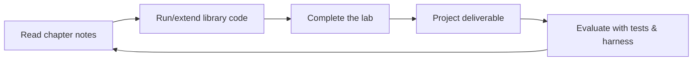

# Chapter 0.1 — Introduction to the Repository

> Part 0 · Orientation
> Prerequisites: none · Status: complete
> Time: ~20 minutes

## Overview

This repository is a complete learning environment for **Context Engineering** (CE): the discipline of deciding what information a model sees at inference time, obtaining that information, assembling it safely, observing the result, and improving the system with evidence. It is not a link collection or a list of prompt tricks. By the end you will have built, tested, and evaluated a small context-aware system from first principles.

This chapter explains what is here, who it is for, and how to navigate it. Read it before anything else.

## Who this is for

You will get the most out of this curriculum if you:

- Write or maintain applications that call language models (assistants, RAG systems, agents, copilots).
- Can read and write Python at a working level (see `docs/prerequisites.md` for a checklist).
- Have been surprised by a model "knowing" something wrong, or "forgetting" something you sent it, and want to understand why.

You do **not** need machine-learning theory, a paid API account, or prior experience with retrieval or agents. Every core concept is demonstrated deterministically and offline.

## What the repository contains

Five kinds of artifacts work together:

1. **Chapter notes** (`chapters/`) — the textbook. Concepts, diagrams, worked examples, exercises, mastery checklists, and dated references.
2. **A reference library** (`src/context_engineering/`) — a small, readable Python implementation of the core components: token estimation, budgeting, assembly, retrieval, memory, security screening, evaluation. It is teaching-grade: clear over clever, honest about limitations.
3. **Labs** (`labs/`) — short, guided experiments tied to chapters, each with a verifiable success criterion.
4. **Projects** (`projects/`) — portfolio builds from beginner to capstone, all runnable offline.
5. **A synthetic corpus and tests** (`datasets/synthetic/`, `tests/`) — the fictional *Nimbus Dynamics* knowledge base that evolves across the entire curriculum, plus the deterministic test suites that define expected behavior.

## How the pieces fit

The same corpus and the same system follow you through the whole curriculum: Part II ingests Nimbus documents, Part III builds the context construction, Part VI secures it, Part VII measures it, and Part IX ships a complete assistant. You are never handed a fresh disconnected example — you evolve one system and watch every layer matter.

## Learning outcomes for the full curriculum

By the end of Part IX you will be able to:

- Classify every piece of a model request into a component kind and reason about its trust level and provenance.
- Estimate token costs and allocate a fixed context budget under competing priorities.
- Build and evaluate retrieval, selection, and assembly stages — and say precisely which stage failed when quality drops.
- Manage conversation history, persistent memory, and task state without silent staleness.
- Design tool and multi-step agent contexts that aid rather than confuse a model.
- Treat security (injection, access control, tenancy) as architecture, not prompt wording.
- Run an evaluation suite, read its report, run an ablation, and improve the system based on evidence.

## How to use this repository

1. Start with `docs/getting-started.md` and run the test suite — this proves your environment works before you need it.
2. Read chapters in order; the curriculum is dependency-ordered (`CURRICULUM.md` shows the graph).
3. Always do the chapter's beginner exercise; do one intermediate exercise per part.
4. Never trust an example you have not run.
5. Use the mastery checklist at the end of each chapter to decide whether to move on.

## Exercises

1. **Beginner** — Browse `CURRICULUM.md` and write down which two parts you expect to be hardest for you. Revisit this guess at the capstone.
2. **Intermediate** — Skim the module list in `docs/development-guide.md` and predict, before reading further, which module implements "decide what to drop when the context is too big."
3. **Advanced** — In one paragraph, explain to a colleague the difference between prompt engineering and context engineering. Keep the paragraph; Part I will let you grade yourself.

## Mastery checklist

- [ ] I can state what this repository teaches and name its five artifact types.
- [ ] I know where chapters, code, labs, projects, and datasets live.
- [ ] I have run the test suite at least once.

## Next

`chapter-02-prerequisites.md` — verify your background is sufficient, then set up the environment and run the first experiment in Chapter 0.3.
