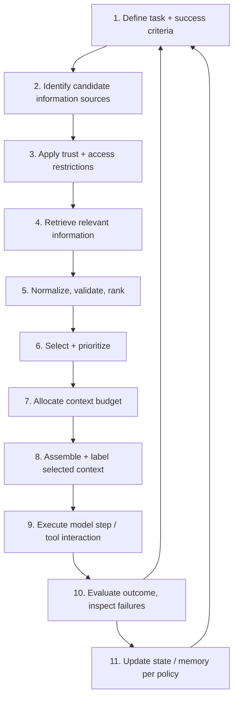
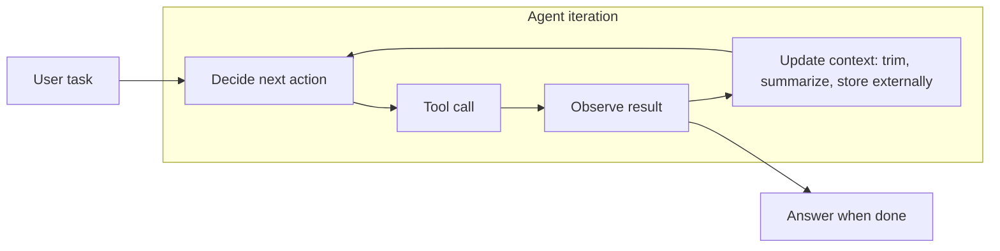

# Chapter 1 — Context Engineering Fundamentals

> Part I · Foundations
> Prerequisites: Part 0 · Status: complete
> Time: ~60 minutes

## Overview

This chapter defines Context Engineering as a discipline, explains why it emerged as a distinct engineering practice, draws its boundaries against adjacent disciplines, and introduces the lifecycle that organizes the entire curriculum. After this chapter, every other chapter is a deepening of one lifecycle stage. If you have done professional work with LLM applications, expect several "so that's what I've been doing badly" moments here.

## Why this discipline exists

A language model is, in engineering terms, a **stateless function over text**: it receives one request, produces one response, and retains nothing. Everything it "knows" about your product, your user, today's date, your database, or the conversation so far must be supplied, explicitly and deliberately, in that request. This is not a limitation to work around — it is *the* defining constraint of the field, and it converts a soft skill ("write better prompts") into a hard engineering problem ("manage a scarce, contested, risky information channel").

The channel is scarce because models accept a bounded amount of input per request (the context window). It is contested because every part of your system wants space in it: instructions, conversation history, retrieved documents, memory, tool definitions, tool results, application state. It is risky because whatever enters it can influence the model's behavior — including content written by strangers (retrieved web pages, uploaded documents) who may not have your users' interests at heart.

Context Engineering is the systematic design and management of this channel: **selecting, retrieving, structuring, ordering, compressing, labeling, isolating, updating, and evaluating** the information available to the model at a given inference or agent-execution step, across the application's lifecycle.

The term gained popularity in 2025 (notably through public discussion by Andrej Karpathy and Tobi Lütke), but the underlying practice is older — it is what thoughtful RAG, agent, and assistant builders were already doing under names like "prompt assembly" or "knowledge pipeline." Provider guidance converged on the same idea; Anthropic's engineering blog, for instance, frames effective agent design around getting "the right information, at the right time, in the most effective form" into a fundamentally limited context window (reviewed 2026-10-20; see `references/`). Terminology in this field is not standardized across organizations; this repository's definitions are stated explicitly and used consistently, which is what matters for engineering.

## The boundaries: what is and is not Context Engineering

| Discipline | Owns | Boundary with CE |
|---|---|---|
| **Prompt engineering** | Instructions, examples, constraints, output formats — *how to say what you say* | Prompts are one component *inside* the context. Prompt craft remains valuable; it is just not the whole job. |
| **RAG** | Retrieving external evidence to ground responses | RAG is one *source* feeding the context. Context Engineering also covers everything RAG ignores: budgeting, ordering, trust, history, memory, tools. |
| **Memory engineering** | Information retained across interactions | Memory is a source plus its own storage/retention policy. Its *contents* entering a request is a CE decision. |
| **Agent engineering** | Decisions, tools, control flow, execution loops | Agents *consume* context at every step; each step's context is a CE decision. |
| **Data engineering / knowledge management** | Preparing and governing source information | Upstream of CE. Bad corpus → bad context, regardless of assembly skill. |
| **Evaluation engineering** | Measuring whether requirements are met | The feedback loop of CE; you cannot improve what you do not measure. |

These disciplines overlap in practice — a working engineer wears all of them — but keeping the boundaries crisp lets you attribute failures correctly. "The model ignores my retrieved section" might be a prompt problem (unclear instructions), a retrieval problem (wrong documents), an assembly problem (evidence truncated mid-sentence), an ordering problem (evidence buried mid-context), or a security problem (untrusted text hijacking the instructions). The rest of the curriculum is largely about making that diagnosis quickly.

Companion boundaries within the author's ecosystem: prompt-writing technique is taught in the [`Prompt-Engineering`](https://github.com/AdilShamim8/Prompt-Engineering) repository; the overall GenAI journey — with its own high-level context-engineering rung — is the [`GenAI-Roadmap-with-Notes-and-Projects`](https://github.com/AdilShamim8/GenAI-Roadmap-with-Notes-and-Projects) repository. This repository owns the deep engineering.

## The context engineering lifecycle

The curriculum is organized around a 12-step lifecycle (fully specified in Chapter 10). At concept level:

Three properties of this lifecycle matter more than the exact steps:

1. **It is a loop.** Step 10 feeds step 1. Every production context system improves through this loop or silently rots (corpus drift, model updates, user behavior changes).
2. **Not every application needs every stage.** A single-shot classifier may need only steps 1–3 and 8–9. The skill is knowing which stages your application *actually* requires — and the cost of discovering a missing stage in production.
3. **Security is not a stage; it is a property of every stage.** Access control applies at step 3, trust labeling at step 8, output validation at step 9. Chapter 24 makes this concrete.

## Representative architectures

The curriculum teaches three reference architectures, increasing in context complexity:

1. **Single-shot QA / task** — instructions + user input + (optionally) retrieved evidence. Budgeting and trust are already non-trivial here.
2. **Conversational assistant** — adds history (Part IV): the context must now represent *this turn* correctly, not just the current message.
3. **Agent loop** — adds tools and multi-step state (Part V): each iteration re-decides the context; intermediate results accumulate and must be compressed or externalized (Chapter 14, 15).

## What good looks like (and how it fails)

A well-engineered context system is **inspectable** (you can see exactly what the model saw), **justified** (every inclusion/exclusion has a policy behind it), **budgeted** (nothing important is silently truncated), **labeled** (trusted instructions are distinguishable from untrusted data), and **measured** (quality metrics exist and move when you change the system). Each property is a recurring theme with a dedicated chapter.

The dominant failure pattern across the industry is the opposite: assembled strings built by accretion — a prompt here, a retrieved blob there, a history array appended without bound — until nobody knows what the model sees, failures are diagnosed by superstition, and the only available fix is "add more instructions." This curriculum's whole purpose is to replace that pattern with engineering.

## Exercises

1. **Beginner** — Take an application you know (or imagine one) and map its request contents onto the anatomy in Chapter 3's table. Note anything you cannot classify — that ambiguity is where failures will live.
2. **Intermediate** — Write the "boundary defense": a colleague says "RAG and context engineering are the same thing." In five sentences, using the table above, explain why RAG alone leaves their users exposed to stale, contradictory, or unauthorized answers.
3. **Advanced** — Design the two architectures you would use for (a) a document Q&A tool and (b) a coding agent, and state which lifecycle steps each one can legitimately skip. Justify each skip with a failure scenario that would change your mind.

## Common failures

- **Category error:** treating context engineering as prompt engineering with extra steps. The result: teams iterate on instruction wording while the actual defect is stale retrieval or budget overflow.
- **No owner:** the context is assembled by whichever component last touched the prompt string. Symptoms: unexplainable regressions, config sprawl, "works on my machine."
- **Invisible assembly:** nobody can print what the model saw. If you cannot run `inspect` on your production system, that is your first project.

## Summary

- Context Engineering = managing the scarce, contested, risky information channel into a stateless function.
- Prompts are one component; RAG and memory are sources; agents are consumers; evaluation is the loop.
- The 12-step lifecycle organizes the curriculum; it is iterative, subsettable, and security-bearing at every stage.
- Good systems are inspectable, justified, budgeted, labeled, and measured.

## Mastery checklist

- [ ] I can define CE from memory and distinguish it from all six adjacent disciplines.
- [ ] I can sketch the lifecycle and say which steps my application needs (and which it skips at known risk).
- [ ] I can name the three reference architectures and what each adds.

## Review questions

1. Why does the statelessness of models make information management an *engineering* problem rather than a writing problem?
2. Which lifecycle step is the first one that can leak unauthorized data into a request — and why is the intuitive answer (assembly) wrong?
3. Give one concrete way "RAG" and "context engineering" would disagree about a stale-document scenario.

## References

- Anthropic, *Effective context engineering for AI agents* — https://www.anthropic.com/engineering/effective-context-engineering-for-ai-agents (reviewed 2026-10-20)
- Microsoft, *AI Agents for Beginners*, Module 12: Context Engineering — https://github.com/microsoft/ai-agents-for-beginners/tree/main/12-context-engineering (reviewed 2026-10-20)
- OpenAI, *Harness engineering: leveraging Codex in an agent-first world* — https://openai.com/index/harness-engineering/ (reviewed 2026-10-20)
- Companion repositories (scope boundaries): `Prompt-Engineering` and `GenAI-Roadmap-with-Notes-and-Projects` — see this chapter's "Companion boundaries."
- Full, dated bibliography: [`references/references.md`](../../references/references.md)

## Next

Chapter 2 quantifies the scarce resource: tokens and the context window.
