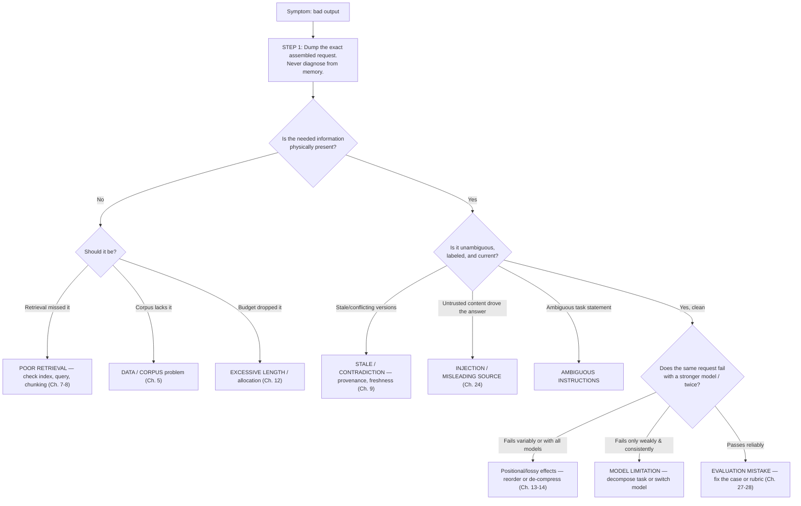

# Chapter 4 — Context Quality and Failure Diagnosis

> Part I · Foundations
> Prerequisites: Chapters 2, 3 · Status: complete
> Time: ~75 minutes

## Overview

Every context failure you will ever debug is one of a small number of kinds, and every "the model is hallucinating" ticket reduces to one of five root-cause families — only one of which is actually the model. This chapter gives you the failure taxonomy, a diagnostic process that separates context problems from model limitations, data problems, application bugs, and evaluation mistakes, and worked examples of each. This is the chapter you will return to most often in practice, and the mental model that the Part VII observability tooling is designed to serve.

## The failure taxonomy

| # | Failure kind | Mechanism | Typical symptom | Treated in depth |
|---|---|---|---|---|
| 1 | **Missing information** | Required evidence absent from the request | Confident invention, or wrong-by-omission answers | Ch. 7, 8, 27 |
| 2 | **Irrelevant context** | Noise included; distracts and dilutes | Answers the wrong document; "confused" behavior | Ch. 11, 13 |
| 3 | **Excessive length** | Budget overflow; silent truncation by you or the provider | Key instructions or evidence lost; cut-off answers | Ch. 2, 12 |
| 4 | **Contradiction** | Fresh and stale (or conflicting) sources both present, unlabeled | Randomly correct answers; inconsistent behavior between sessions | Ch. 9, 10 |
| 5 | **Stale evidence** | Superseded version retrieved as if current | Confident, citable, wrong — Lab 00 scenario 3 | Ch. 9, 26 |
| 6 | **Poor retrieval** | Relevant document exists but is not found (query mismatch, bad chunking) | "I don't know" despite available knowledge | Ch. 7, 8 |
| 7 | **Misleading source content** | Untrusted content is wrong or adversarial | Model asserts falsehoods from poisoned sources; injection succeeds | Ch. 24, 25 |
| 8 | **Ambiguous instructions** | Under-specified task/constraints in the request | Format drift; wrong scope; "disobedience" | Prompt engineering (companion repo) |
| 9 | **Lossy transformation** | Summarization/compression dropped critical details | Numbers, exceptions, or identifiers silently vanish | Ch. 14, 28 |
| 10 | **Positional loss** | Key evidence buried where the model uses it poorly | Works when evidence moved, fails in the middle of long context | Ch. 13 |

Two failures deserve special emphasis because they are systematically under-diagnosed. **Stale evidence (5)** never looks broken from the inside: the model had *a* correct-at-some-point source, cited it, and produced fluent prose — only provenance and freshness policy (Chapter 9) can catch it. **Lossy transformation (9)** compounds silently: each compression step is individually reasonable, and no single step is "the bug."

## The five root-cause families

When output quality is bad, exactly one of these is true (or several in combination):

1. **Context problem** — the request contained the wrong information (the taxonomy above).
2. **Model limitation** — the information was right, but the model lacked capability (reasoning depth, instruction-following strength, format discipline).
3. **Data problem** — the source of truth itself is wrong, incomplete, or inconsistent; context faithfully delivered garbage.
4. **Application bug** — code between your intent and the request (off-by-one in selection, a swapped variable, an unserialized tool result) corrupted the context.
5. **Evaluation mistake** — the system worked; your test or judgment was wrong (bad golden case, ambiguous rubric, nondeterministic comparison).

The families demand different fixes: context problems are fixed in the pipeline; model limitations by switching or improving models or decomposing tasks (Part V); data problems in the corpus (Part II); application bugs in code; evaluation mistakes in the harness (Part VII). **Fixing the wrong family is the most expensive mistake in this discipline** — it produces prompt-text iterations that cannot work while the real defect (e.g., a retrieval filter that excludes the right document) persists untouched.

## The diagnostic process

The discipline embedded in that flowchart:

- **Step 1 is non-negotiable.** You dump the assembled request (`inspect` in this repository; a request log in production). Diagnosis from memory of what you *meant* to send is astrology.
- **Presence before quality.** First ask "is the fact physically in the request," then "is it usable." Different families, different fixes.
- **Change one variable.** Swap the model, or reorder evidence, or fix the corpus — never simultaneously — or you learn nothing (Chapter 28 formalizes this as ablation).

## Worked examples

**Example A — "The assistant contradicts itself between sessions."** Dump two requests. Both contain two chunks from `hr-remote-work` — v2 (2026) and a superseded v1 (2024), present with no labels, order varying with retrieval scores. Diagnosis: CONTRADICTION + STALE, a context problem. Fix: version-aware retrieval returning only the current version, plus effective-date labels at assembly (Chapter 9). Prompt wording is irrelevant here; no amount of "make sure to use the latest policy" substitutes for version selection.

**Example B — "The model invents a refund policy."** Dump the request: no evidence about refunds at all — retrieval returned shipping chunks (lexical overlap on "policy"). Diagnosis: POOR RETRIEVAL (6) plus MISSING INFORMATION (1) — the model did the only thing possible with no evidence: it generated plausible text. Fix the retrieval (better query construction, Chapter 8) and make refusal-on-no-evidence the default behavior (Part IX). Note the model-side observation: models trained to be helpful will *often* answer rather than abstain when the context permits interpretation — so the system must make refusal the structurally supported path.

**Example C — "It keeps citing the right doc with the wrong number."** Dump the request: the chunk was truncated mid-sentence by budget allocation — "refund window is…" cut at the window. Diagnosis: LOSSY TRANSFORMATION (9) via truncation policy. Fix: the allocator's evidence truncation policy (head-priority with markers — Chapter 12), or a smaller history allocation.

**Example D — "Works on my machine, fails in CI."** CI's golden case expects "3 remote days" — written from the old policy. The system is right; the case is stale. Diagnosis: EVALUATION MISTAKE (5). Fix the dataset and add a corpus-version field to golden cases (Chapter 28) so staleness is detectable automatically.

## The habit loop

Part VII turns this chapter into tooling, but the habit starts now: every time output disappoints — (1) dump the request; (2) classify against the taxonomy; (3) identify the root-cause family; (4) change exactly one thing; (5) re-measure. Engineers who follow this loop converge on fixes; engineers who don't, iterate on prompt folklore.

## Exercises

1. **Beginner** — Take Lab 00 scenario 3 and classify it fully: taxonomy number, family, and the two possible fixes (one in retrieval, one in assembly labeling).
2. **Intermediate** — Write a one-page "diagnosis checklist" for a teammate: the five families, the two questions from the flowchart, and the dump-the-request rule. Trade with another learner and critique.
3. **Advanced** — Construct a composite failure: a request that simultaneously exhibits #5 (stale), #9 (lossy), and #3 (excessive length). Diagnose it via the flowchart and state the order in which you would fix the three, justifying with cost/risk.

## Common failures (of the diagnostician)

- **Diagnosing without the request dump.** The most common meta-failure; it converts debugging into superstition.
- **Family confusion.** Treating a data problem (corpus) as a model problem ("try a bigger model") — expensive and ineffective.
- **Multi-variable fixes.** Changing prompt, retrieval, and model in one afternoon, then being unable to attribute the improvement.

## Summary

- Ten failure kinds, five root-cause families; every bad output reduces to them.
- Staleness and lossy transformation are the two sneaky ones: neither looks broken from inside the request.
- The diagnostic loop — dump, classify, single-variable change, re-measure — is the professional core of the discipline.

## Mastery checklist

- [ ] I can name the ten failure kinds and give a mechanism + symptom for each.
- [ ] Given a bad output, I can walk the flowchart aloud and land on a family.
- [ ] I can explain why step 1 (dump the request) outranks every other step.

## Review questions

1. Why does "confident, citable, wrong" almost always indicate a context (not model) failure? Which two taxonomy kinds produce it?
2. Distinguish a data problem from a retrieval problem, and name the evidence that separates them.
3. Why is changing two things at once a *methodological* failure rather than just impatience?

## References

- Liu et al., *Lost in the Middle* (positional loss evidence) — https://arxiv.org/abs/2307.03172 (reviewed 2026-10-20)
- OWASP LLM Top 10 — risk framing for misleading/untrusted inputs — https://genai.owasp.org/ (reviewed 2026-10-20)
- Tooling chapters: 27 (metrics), 28 (ablation), 29 (traces) operationalize this chapter.

## Next

Part II moves from diagnosis to construction: building the knowledge corpus that prevents failures 1, 4, 5, 6, and 7 at the source.
