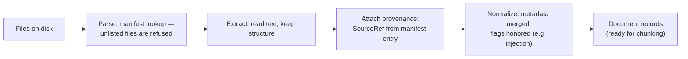

# Chapter 6 — Document Ingestion and Normalization

> Part II · Knowledge Sources
> Prerequisites: Chapter 5 · Status: complete
> Time: ~45 minutes

## Overview

Ingestion is where raw files become context-ready records — and where most provenance is either preserved forever or lost forever. This chapter covers parsing, text extraction, structure preservation, normalization, and metadata propagation, all implemented in the loader you will read (`src/context_engineering/corpus.py`). The chapter's running theme: **ingestion is a contract with the future.** Every property you fail to preserve here (heading structure, effective date, access class) is a capability you cannot add later without re-ingesting everything.

## The ingestion pipeline

Read `load_corpus()` in `corpus.py` alongside this diagram — it is ~40 lines and implements exactly this. Two strictness decisions are worth internalizing:

1. **Manifest-listed but missing file → exception.** The corpus is inconsistent; fail loudly (Chapter 30's "loud beats silent" principle).
2. **File present but not in manifest → never loaded.** Ingestion without registration is how corpora drift.

## Parsing and extraction in the real world

This repository ingests markdown, which is already text — deliberately, so the *engineering* lessons are visible. Production ingestion faces harder formats, and the failure modes are worth naming:

- **PDFs**: visual layout is not logical structure. Two-column layouts interleave columns; tables extract as word salad; headers/footers repeat on every page. Extraction quality is a *measured* property (sample, inspect, score), not a library promise.
- **HTML**: boilerplate (nav, ads, cookie banners) must be stripped or it becomes 60% of your chunks. Main-content extraction is its own sub-discipline.
- **Spreadsheets**: rows are records, not prose; flattening a table into sentences destroys the relationships. Tables often deserve structured (not chunked) treatment, entering context as structured data (Chapter 3's STATE/DERIVED kinds).
- **Scans/images**: OCR introduces errors that then get retrieved confidently. OCR'd text is a *derived representation* (Chapter 3) — its provenance should say so.

Whatever the format, the invariant is identical: **extract text with structure, attach provenance, refuse silently-degraded output.** "Garbage in, retrieved confidently out" is the ingestion failure pattern; the counter is inspection — print chunks and *look at them* (Chapter 29 makes this systematic).

## Structure preservation

Headings, lists, and tables carry meaning that naive extraction destroys. Compare two ingestion policies for a section "## Approval Process / Requests must be approved 48 hours in advance":

- Flat: one blob of prose — the phrase "Approval Process" may or may not end up adjacent to its rules.
- Structure-aware (this repo): the heading travels with its paragraphs into every chunk derived from them, so retrieval can match "approval" questions precisely, and the chunk itself testifies to its topic.

`load_chunks()` does the second: `chunk_markdown` keeps (heading, paragraph) pairs, and the loader composes `"{heading}. {body}"` so the heading text is *inside* the indexed chunk. Cost: a few tokens per chunk. Benefit: retrieval precision + self-describing evidence. This trade — small token overhead for large semantic clarity — recurs throughout the curriculum.

## Normalization decisions (and their reversibility)

Normalization choices to make consciously, because each discards information:

| Choice | Gains | Loses |
|---|---|---|
| Strip whitespace/markup noise | cleaner chunks | little, if structure kept |
| Unicode normalization (NFKC) | consistent matching | exotic-but-meaningful glyph distinctions |
| Lowercasing *stored* text | simpler matching | case-based signal (e.g., acronyms); this repo lowercases only at retrieval time, in the index, not in storage |
| Dropping "boilerplate" sections | budget | sometimes the boilerplate was the policy |

The safe default: **store maximally faithful text; normalize at use time, reversibly where possible.** The Nimbus corpus stores the markdown as-is; `LexicalIndex.tokenize` lowercases per-query/per-chunk transiently (storage untouched).

## Metadata propagation

Note how `load_chunks` carries the manifest entry forward: `Document.metadata` → chunk metadata. The `synthetic_injection` flag survives ingestion, which is what lets Part VI screen flagged chunks differently without re-reading files. The general rule: **ingestion output should answer every question retrieval, security, and evaluation will later ask** — source, version, date, access, owner, section heading, ordinal position, fixture flags. Anything you wish you knew downstream, emit here.

## Worked example: ingesting a new document

Say people-ops publishes `hr-vacation v4`. The correct ingestion sequence: write the file; add a manifest entry with `id`, `version: "4"`, `effective_date`, `access: internal`, `owner: people-ops`, and `supersedes: hr-vacation v3`; run the integration tests (they will now expect v4 to win version selection); update any golden cases that pinned v3 facts (Chapter 28). Notice that ingesting a new version is a *corpus event* with test consequences, not a file copy — and notice how quickly the tests caught a mistake you would otherwise have shipped.

## Exercises

1. **Beginner** — Add a `glossary.md` document to the corpus (public, owned by architecture-council) and a matching manifest entry. Verify with `load_corpus()`.
2. **Intermediate** — Modify `load_chunks` to also record `doc_path` in chunk metadata. Then explain which downstream stages (audit? debugging? citations?) want the path, and which do not (hint: paths in *model-visible* text leak filesystem layout — Chapter 25).
3. **Advanced** — Implement a `normalize_report(corpus_dir)` that flags documents with missing owners, missing dates, or no access level. Run it on the corpus; everything should pass except… whatever you forgot when you added your glossary. Fix it.

## Common failures

- **Ingesting everything, curating nothing.** The corpus grows by accretion; authority dissolves. Cure: manifest registration + owner per document.
- **Boilerplate chunks.** Nav menus, "Last updated" strings, and TOCs become high-scoring chunks for navigational queries. Cure: strip boilerplate *at ingestion*, then chunk.
- **Structure-blind chunking.** Boundary cuts mid-clause (Chapter 7 quantifies this). Cure: structure-aware chunking, at the cost of variable chunk sizes.

## Summary

- Ingestion = parse → extract → attach provenance → normalize, with strictness at both ends (refuse unlisted files, raise on missing files).
- Extraction quality must be inspected, not assumed; derived representations must be labeled as such.
- Preserve structure and metadata at ingestion — every downstream capability depends on it.

## Mastery checklist

- [ ] I can trace a manifest entry through `load_corpus` into chunk metadata.
- [ ] I can name the per-format extraction risks (PDF/HTML/spreadsheet/OCR) and the shared invariant.
- [ ] I can ingest a new document version so that tests catch my mistakes.

## Review questions

1. Why does this repository lowercase at retrieval time instead of at storage time?
2. What makes OCR text a "derived representation," and what should its provenance say?
3. Which ingestion decision is irreversible, and why does that raise its stakes?

## References

- Implementation: `src/context_engineering/corpus.py`, `chunking.py`; governance tests in `tests/integration/test_corpus_pipeline.py`.

## Next

Chapter 7: chunk sizes, boundaries, and the machinery of retrieval.
