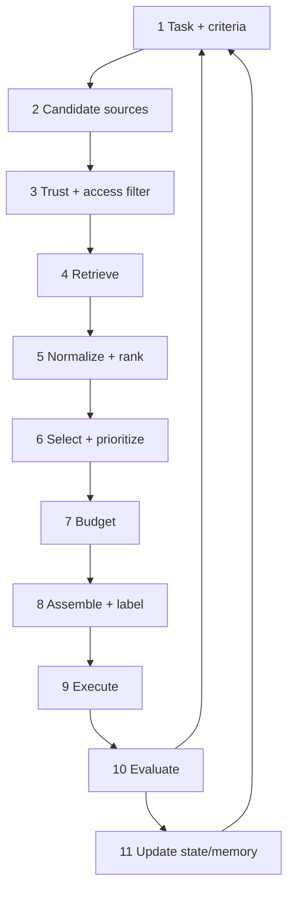

# Chapter 10 — The Context Engineering Lifecycle

> Part III · Dynamic Context Construction
> Prerequisites: Part II · Status: complete
> Time: ~60 minutes

## Overview

Part II ended with a governed pile of candidates. Part III is about the decisions that turn candidates into a model request, and this chapter gives those decisions their skeleton: a 12-step lifecycle, implemented in miniature by `pipeline.py` (each stage a named function with retries, fallbacks, and degradation). The lifecycle is the curriculum's map — every remaining chapter is a deepening of one step, and every production failure you will debug maps to a step that was skipped or faked.

## The twelve steps

1. **Define the task and success criteria.** What must this step produce? What counts as good? (Chapter 27 turns criteria into metrics; without them, every later step is unfalsifiable.)
2. **Identify candidate information sources.** Instructions, history, memory, corpus, tools, state — which *could* matter for this step?
3. **Apply trust and access restrictions.** Filter candidates by authorization and trust policy *before* further work (Chapter 9). Unauthorized data never enters the pipeline at all.
4. **Retrieve relevant information.** Query construction and ranking (Chapters 7–8).
5. **Normalize, validate, and rank candidates.** Structure, deduplicate, freshness-check (Chapters 6, 9, 11).
6. **Select and prioritize.** Composite relevance/diversity decisions (Chapter 11).
7. **Allocate the context budget.** What fits, in what order of precedence, with what truncation policy (Chapter 12).
8. **Assemble and label.** Order, delimit, label trust and provenance (Chapters 13, 24).
9. **Execute the model step or tool interaction.** The one step most teams build first — and the one this curriculum deliberately built last.
10. **Evaluate the outcome and inspect failures.** Did the step meet its criteria? Where did it break? (Chapters 4, 27–29.)
11. **Update task state or memory per policy.** Commit durable learnings; discard the rest (Chapters 18–19).
12. **Improve the process using evidence.** Feed findings back into steps 1–8 (Chapter 28's ablations; Chapter 32's regression gates).



## Reading the lifecycle correctly

**It is a loop, not a checklist.** Step 10 feeds step 1 in the small way (this request) and the big way (this system, over weeks: corpus drift, model changes, usage patterns). The teams that suffer most are those that treat steps 10–12 as optional "later, when we have dashboards" — they have no mechanism for noticing that their context quietly rotted.

**Steps are subsettable — with named risks.** A single-shot extractor with two inputs may legitimately need only 1, 2, 3 (trivially), 8, 9, 10. What matters is that skipping is *decided*, not accidental. For each skipped step, name what failure it was there to catch: no version selection (skip 5) → stale answers; no budgeting (skip 7) → silent provider truncation; no evaluation (skip 10) → regression blindness.

**Security is not a step; it is a property of every step.** Step 3 is the explicit checkpoint, but trust labels attach at 8, screening at 5–6, output validation at 9–10, redaction at 10–11. The lifecycle diagram hides this for readability; your architecture must not (Chapter 24).

**The steps are a *language* for diagnosis.** "The assistant hallucinated" becomes "step 4 found nothing relevant; the failure is retrieval (or step 2: the corpus lacks the answer)" — which is a fixable claim. Chapter 4's five root-cause families are the diagnosis; the 12 steps are the anatomy being diagnosed.

## From lifecycle to code: `pipeline.py`

The library's `Pipeline` implements the lifecycle's *shape* so each step is a small, individually tested function:

```python
from context_engineering.pipeline import Pipeline

pipeline = Pipeline("assistant-request")
pipeline.add_stage("retrieve", retrieve_stage, retries=2, fallback=empty_results)
pipeline.add_stage("screen", security_screen_stage, required=False)   # degrade, don't die
pipeline.add_stage("select", selection_stage)
pipeline.add_stage("budget", budget_stage)                            # required: no silent overflow
pipeline.add_stage("assemble", assembly_stage, required=True)
trace = []
payload = pipeline.run({"question": q, "access_policy": policy}, trace=trace)
```

Design decisions to notice (each is Chapter 30 material, previewed): **required vs. optional stages** (an assembler failure must stop the request; a screening hiccup must not), **retries with fallbacks** (transient retrieval failure → degrade to empty evidence and let refusal semantics protect the user, rather than crash), and **the trace** (every stage's outcome recorded — steps 10 and 29 live on this). A pipeline that cannot explain what it did is a pipeline you cannot debug.

## What each remaining Part III chapter deepens

| Step | Chapter |
|---|---|
| 5–6 | Chapter 11 (selection and relevance) |
| 7 | Chapter 12 (budgeting) |
| 8 | Chapters 13 (ordering), 14 (compression feeding 7) |
| 6–8 alternative strategy | Chapter 15 (progressive disclosure — retrieve *less*, on purpose) |
| 4–8 efficiency | Chapter 16 (caching and reuse) |

## Exercises

1. **Beginner** — Map your favorite production LLM feature (or a public one you have used) onto the 12 steps. Identify the two steps it most visibly skipped, and name the failure you would expect because of each.
2. **Intermediate** — Implement `budget_stage` as a pipeline stage that takes selected components from the payload, allocates them under a `ContextBudget`, and stores both the selected list *and the allocation report* in the payload. Write the trace assertion proving the report reaches step 10.
3. **Advanced** — Design the degraded-mode ladder for an assistant whose retrieval stage fails entirely: what should steps 8–9 do, what must the user see, and what must *never* happen (hint: Chapter 24 — the temptation to "just answer from the model's own knowledge"). Implement it as fallbacks and test the full ladder.

## Common failures

- **Checklist theater.** Posters of the lifecycle on the wall; steps 3, 7, 10 skipped in code. The lifecycle earns its place only when steps map to named functions and traces.
- **Silent skipping.** Budgeting "temporarily" disabled during development; nothing re-enables it. Every skip needs a trace record and an owner.
- **Big-bang evaluation.** Allowing evaluation only at the end (step 10 as a phase) instead of per-request. Per-step criteria are what make mid-pipeline failures visible.

## Summary

- Twelve steps from task definition to evidence-driven improvement; a loop, subsettable by decision, security-bearing throughout.
- `pipeline.py` implements the shape: named stages, retries/fallbacks, required/optional, traced execution.
- The lifecycle's real value is diagnostic: bad outputs resolve to specific steps with specific fixes.

## Mastery checklist

- [ ] I can name the 12 steps and the chapter that deepens each.
- [ ] I can decide, with a named risk, which steps a given application can skip.
- [ ] I can build a pipeline with a degradation ladder and defend each required/optional choice.

## Review questions

1. Why is "the model hallucinated" an unusable diagnosis, and how does the lifecycle fix it?
2. Which steps does progressive disclosure (Chapter 15) collapse or defer, and at what cost?
3. Why must the budget stage be `required=True` in the sample pipeline?

## References

- Implementation: `src/context_engineering/pipeline.py`, tests `tests/unit/test_pipeline.py`.
- Anthropic, *Effective context engineering for AI agents* — the iterate-and-compact loop in agent practice — https://www.anthropic.com/engineering/effective-context-engineering-for-ai-agents (reviewed 2026-10-20)

## Next

Chapter 11: selection — what actually earns a place in the context.
