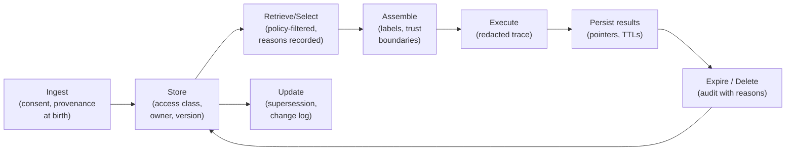

# Chapter 26 — Provenance, Governance, and Lifecycle Management

> Part VI · Security, Privacy, and Governance
> Prerequisites: Chapters 9, 18, 24, 25 · Status: complete
> Time: ~50 minutes

## Overview

Governance is the part of context engineering that answers, months later, questions you are not expecting: *why did the assistant say that in March? Who authorized that corpus change? What did the system know about this user, and when?* This chapter assembles the audit-and-lifecycle machinery the previous chapters built piecemeal into a coherent governance program: the data lifecycle end to end, traceability as an architecture property (not a logging afterthought), retention and change management, and the honesty trail that separates a professional system from a demo. Nothing here is new code; it is the existing mechanisms — provenance, traces, audit logs, checkpoints, manifest — viewed as one system with one job: **making the past inspectable.**

## The lifecycle, end to end

Context data has a life, and every stage of it is a governance decision:

The questions governance must be able to answer *at any point later* map to stages: **Where did this fact come from?** (provenance, born at ingestion — Chapter 5/6). **Which version, and why the current one?** (manifest + selection rules — Chapter 9). **What exactly did the model see on March 3rd?** (traces — Chapter 29). **Who changed the corpus last week?** (change management, below). **When was this user's data deleted, and everything derived from it?** (Chapter 25's boundaries + Chapter 18's audit trail). A governance gap is any of these questions your architecture answers with "probably."

## Traceability as an architecture property

The trap this chapter exists to prevent: "we'll add audit logging later." Later-logging bolts onto systems that *have structure to log* — it cannot recover the structure that was never there. The properties that make a system governable, all already built in this curriculum:

1. **Components with identity.** Every piece of context carries id/kind/trust/source (`context.py`) — answers can cite, traces can reference, audits can reconstruct.
2. **Decisions with reasons.** Allocation reports (Ch. 12), selection ranks (Ch. 11), screening findings (Ch. 24), freshness verdicts (Ch. 9), memory conflicts (Ch. 18) — each records *why*, in machine-readable form. An audit trail of outcomes without reasons explains nothing.
3. **Traces of structure, not content.** Chapter 29's rule (redacted by default, decisions not payloads) is the governance-compatible way to make step 2 durable without becoming a data warehouse (Chapter 25).
4. **Immutable-ish memory of change.** Corpus manifests version content (Ch. 5); the memory store's audit events (Ch. 18) and checkpoint timestamps (Ch. 19) version behavior.

Together: a March 3rd answer reconstructs as *question → policy objects → retrieved ids with scores → selection reasons → allocation record → assembled structure (redacted) → screening verdicts → answer with citations*. Not because someone logged everything, but because every subsystem already produced its explanation as its normal mode of operation. **Explainability is an emergent property of structured systems — you cannot add it; you build it.**

## Retention and change management

**Retention**: every artifact class in the diagram needs an explicit lifetime, set by its *purpose*, not by storage convenience: traces (short — days, for debugging), checkpoints (task lifetime), memory (user-controlled + Chapter 18 TTLs), corpus (versioned indefinitely, audit-relevant), caches (event + TTL — Chapter 16). The governance review question that catches violations: *for each artifact, name the event that deletes it.* "Nothing deletes it" is the answer that precedes every retention incident ever reported.

**Change management**: the corpus is load-bearing infrastructure, so treat changes like code changes. The minimal working ceremony, proportional to a learning repository: manifest entries updated atomically with content (the loader enforces agreement — Chapter 5's tests), supersession recorded (`supersedes`), a change note in the commit message ("hr-vacation v4: carryover window clarified"), and golden-case updates in the same commit (Chapter 28's staleness detection). At production scale, add review gates on ingestion (who approves a new source? an owner per document — already in the manifest) and regression runs on corpus change (the eval suite gates it — Part VII).

## Evidence without surveillance

The tension governance must resolve: enough evidence to answer the questions above, without the evidence itself becoming the privacy problem. Three rules reconcile it, each seen already:

1. **Decisions over content.** Persist the *why* (findings, reasons, ids) — the *what* (payloads, assembled text) is reconstructible from sources when legitimately needed, so it need not be archived by default. Traces keep structure, redact content.
2. **Short retention as the default, exceptions by justification.** The general direction: keep the shortest trace that answers your real debugging questions, and lengthen deliberately when measurement (Chapter 29's latency/failure metrics) proves the need — never pre-emptively "just in case."
3. **Pseudo-identifiers where identity is not needed.** User ids in traces can be hashed salts when the question is "how often does this failure happen" rather than "which user hit it." The governance answers rarely need names; they need counts and chains.

## Worked example: the March 3rd question

Compliance asks: "On 2026-03-03 the assistant told an employee the remote-work allowance was 3 days. Show why." The reconstruction, entirely from existing artifacts: the trace references evidence component `hr-remote-work-v1-c01` (id + retrieval score + selection reason: "composite 0.71, ranked 1 of 3") — the *content* isn't in the trace, but the manifest pins v1's effective date and its `superseded_by` field, and corpus history (the git log of the manifest) shows v2 landed 2026-08-14 — *after* March 3rd. Conclusion the evidence supports: on that date, v1 was current, the answer was correct *for its time*, and no failure occurred. Now the counterfactual with a content-dumping, reason-free system: the same question takes an afternoon of inference from prose logs and ends in "probably the retrieval was broken." The governed answer took one manifest join and one git log. **That difference is the entire chapter.**

## Exercises

1. **Beginner** — Write the five questions (lifecycle section) next to your current or imagined system and mark each: answerable from artifacts, answerable with effort, or not answerable. Every "not answerable" is your governance backlog, in priority order.
2. **Intermediate** — Implement the retention ledger: a single table (artifact class → purpose → lifetime → deleting event → where enforced) for all eight artifact classes in the diagram. Find the classes with no deleting event; design one for each; justify each lifetime from its purpose.
3. **Advanced** — Build the March-3rd machine: a `reconstruct(trace_id)` that renders the full decision chain (question → policies → ids → reasons → answer) from stored artifacts without any content in storage — ids resolve to current corpus text only at render time, with supersession warnings when the version has moved. Test it by answering a "why did it say that" question against last week's corpus version.

## Common failures

- **Audit logging as a feature request.** Retro-fitted logging onto unstructured systems produces prose; governance needs chains, which need structure from day one.
- **Content dumps as evidence.** Traces storing assembled requests "for completeness" — the surveillance version of governance (Chapter 25).
- **The immortal trace.** Debug logs kept forever because nobody chose a lifetime; the deletion-event question finds them.
- **Manifest drift.** Content edited without manifest/version updates; the loader catches structural drift but not semantic — review gates (even one-person PRs) are the control.

## Summary

- Governance = answerable-later questions: provenance at birth, decisions with reasons, traces of structure, retention with deleting events, change with supersession.
- Explainability is emergent from structure; it cannot be bolted on.
- Evidence without surveillance: decisions over content, short-by-default retention, pseudo-identifiers where identity isn't the question.

## Mastery checklist

- [ ] I can reconstruct a past answer's decision chain from artifacts alone, and say which artifact each step came from.
- [ ] I can produce the retention ledger with no blank "deleting event" cells.
- [ ] I can argue the evidence-vs-surveillance tradeoff with the three rules, applied to a concrete artifact.

## Review questions

1. Why can't explainability be added later to an unstructured system — name the two structural prerequisites.
2. What question catches retention violations, and why does it work?
3. In the March 3rd reconstruction, which single artifact established that no failure occurred?

## References

- OWASP GenAI Security Project — governance and lifecycle framing — https://genai.owasp.org/ (reviewed 2026-10-20)
- Mechanisms across this repository: `context.py`, `budget.py` (reasons), `selection.py` (ranks/scores in metadata), `security.py` (findings), `memory.py` (audit events), `corpus.py` + manifest (versioning), Chapter 29's traces.

## Next

Part VII: evaluation — turning "it works" into evidence, and evidence into improvement.
